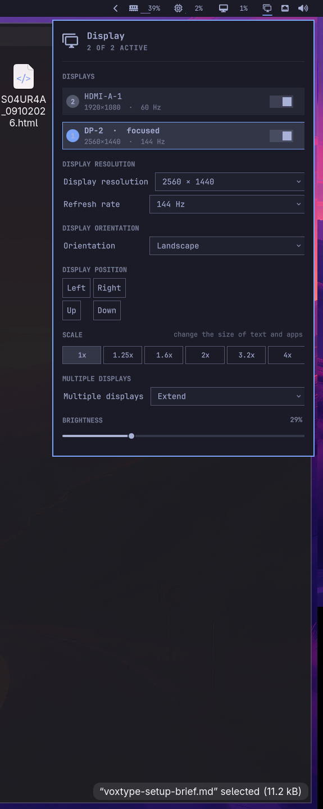

# Display — an Omarchy shell panel

A display-control panel for the [Omarchy](https://omarchy.org/) bar, modelled on
**Windows 11 → Settings → System → Display**, plus workspace-to-monitor binding for
Hyprland.



Click the monitor glyph in the bar and you get, in one popup:

- **A workspace-cell grid.** Not a scaled picture of your desktop — a grid of
  workspace cells numbered `1..N`, one per Hyprland workspace. Each cell shows
  which monitor currently holds it, or *free* when the workspace does not exist
  yet. Click a cell and an inline monitor picker appears under the grid
  (`Bind workspace N to:  HDMI-A-1  DP-2  Cancel`, with the current owner
  highlighted) — click a monitor to move that workspace there.
- **A display list** with an on/off switch per monitor. Like the built-in Display
  panel it reports which output is **focused** rather than offering a user-chosen
  primary screen — Hyprland has no primary output, only drifting focus, so the
  panel shows the honest signal (`· focused`).
- **Per-display settings** in the Windows 11 grouping and order:
  - **Display resolution** — every mode the monitor reports — and **refresh rate**.
  - **Display orientation** — landscape, portrait, and their flipped variants.
  - **Scale**, filtered to values Hyprland accepts for the current resolution.
  - **Multiple displays** — *Extend*, *Duplicate these displays*,
    *Show only on `<name>`*.
  - **Brightness** and **Text size**.
- **Night mode** — a blue-light filter via `hyprsunset` with a colour-temperature
  slider.
- **A 15-second confirmation dialog**, Windows 11 style. Any risky change
  (resolution, refresh rate, orientation, on/off, arrangement, workspace move)
  opens a separate centred window asking *"Keep these display settings?"* with
  **Revert** and **Keep changes**, a countdown bar, and a live "Reverting in Ns"
  label. Do nothing, click the dimmed backdrop, or press Escape and the change is
  rolled back — so a refresh rate your monitor cannot hold never strands you on a
  black screen.

Kept settings are written to a managed block in `~/.config/hypr/monitors.lua`, so
they survive a reload or reboot.

Nothing about the monitor set is hardcoded: displays, resolutions, refresh rates
and geometry all come from `hyprctl monitors all -j`.

## Requirements

- Omarchy 4.x with the Quickshell-based shell (`omarchy-shell`).
- Hyprland with the Lua config (0.56 or newer), as Omarchy ships.
- `hyprsunset` for night mode (present on a stock install).

It relies on these Omarchy commands and tools, all present on a stock install:
`omarchy-monitor-state`, `omarchy-brightness-display`, `omarchy-display-text-size`,
`omarchy-toggle-nightlight`. It also uses `hyprctl`, `bash`, `awk` and `jq`.

## Install

```bash
omarchy plugin add https://github.com/ArseniyAsriyan/omarchy-display-panel.git --enable
```

Enabling adds the widget to the right of the bar. To use it instead of the
built-in one:

```bash
omarchy plugin disable omarchy.monitor
```

### Keybinding

Omarchy's `SUPER + CTRL + D` opens the built-in panel. To open this one instead,
add to `~/.config/hypr/bindings.lua`:

```lua
hl.unbind("SUPER + CTRL + D")
o.bind("SUPER + CTRL + D", "Display", "omarchy-shell shell toggle io.github.arseniyasriyan.display")
```

## What it changes on your system

The plugin runs unsandboxed with your user's permissions, like every shell plugin.
It needs no root, makes no network requests, and does not spawn a second
Quickshell process.

- **Live changes** go through a single batched `hyprctl eval` call
  (`hl.monitor({ ... })` per output, joined in one Lua chunk). Batching matters:
  applied one output at a time, Hyprland auto-shifts each output that would
  overlap a neighbour, so a multi-monitor change can commit a wrong layout.
- **Kept changes are remembered.** After you press *Keep changes*, one
  `hl.monitor(...)` line per display is written into a managed block at the end of
  `~/.config/hypr/monitors.lua`:

  ```lua
  -- >>> display panel: per-monitor layout saved by the Display panel
  hl.monitor({ output = "DP-2", mode = "2560x1440@164.84", position = "0x0", scale = 1, transform = 0 })
  -- <<< display panel
  ```

  A rule with an output name takes precedence over Omarchy's catch-all
  `output = ""` rule, so the choice survives reloads and reboots. Nothing else in
  the file is touched — delete or edit these lines freely.
- **Reverted or ignored changes are not written.** If the countdown expires or you
  press *Revert*, the previous mode, position, scale, orientation and on/off state
  are restored and nothing is saved.
- **Input is validated before it reaches Lua.** Output names must match
  `[A-Za-z0-9._-]+`, modes must match `WxH@R`, positions `auto` or `WxH`, scales
  must be plain numbers. `save-layout.sh` re-validates every field before writing.

## Uninstall

```bash
# 1. Remove the managed block from monitors.lua
sed -i '/-- >>> display panel/,/-- <<< display panel/d' ~/.config/hypr/monitors.lua
hyprctl reload

# 2. Remove the plugin
omarchy plugin remove io.github.arseniyasriyan.display

# 3. Bring the built-in panel back, if you disabled it
omarchy plugin enable omarchy.monitor
```

## Notes and limits

- Brightness applies to the selected monitor.
- Scale choices are limited to values Hyprland accepts cleanly for the current
  resolution.
- Workspace binding uses Hyprland's own workspace→monitor moves; a workspace that
  does not exist yet is created on the target monitor, focused there, then focus
  is returned where it was, so binding does not steal your cursor or keyboard.
- There is no drag-and-drop anywhere in the panel, by necessity: clicking inside
  this style of bar popup dismisses it, which would kill any drag mid-gesture.
  Click-to-bind is the interaction that survives.

## License

MIT. Portions derived from Omarchy's built-in Display panel,
© David Heinemeier Hansson, MIT. See [LICENSE](LICENSE).
